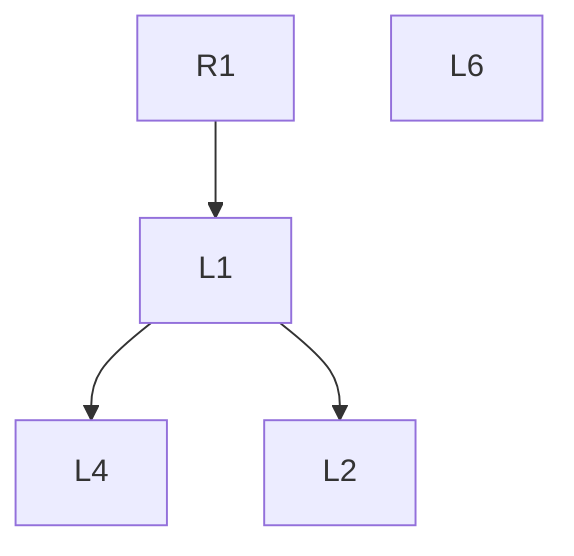

# strict-leftovers — design

Date: 2026-10-15
Package: `strict-workday`
Skill: `strict-leftovers`

## Problem

A task is small, but the work around it grows. Review findings, agent suggestions, side questions, and
the user's own "would be cool" remarks pile up in the session. Each one is plausible. Together they pull
the work away from the requirements, cost a context switch each, and leave the user with a drained head
and no clear picture of what is still open.

Two losses follow. Problems and decisions get lost between sessions and after context compaction. And
nobody can see which item grew out of which, so drift away from the requirement stays invisible until
the task has doubled.

## Intent

A journal of what is left on a task, kept so the list shrinks with every pass instead of growing.

- The user reads less: counts and the open list only, everything else on request.
- Nothing is reworded. Questions and decisions are stored verbatim, so the original meaning survives.
- The user sees what pulled in what, and how far each item is from a requirement.

## Goals

- `/strict-leftovers` scans the session since its last run and records new questions, findings, and
  decisions into one file per task.
- Every entry keeps the exact wording of its source message.
- Every entry links to where it came from: a requirement or another entry.
- The chat output shows three counts and the `Open` list, ordered so the most relevant item is first.

## Non-goals

- Deciding for the user. The skill records and orders; the user decides.
- Background capture. The skill writes only when invoked.
- Forecasting blast radius or scoring impact. Separate atomic skills may do that later.
- Creating tracker tickets. A backlog link is recorded only when the user supplies one.

## Anti-goals

The skill fails, even if it technically works, when:

- the `Open` list grows because of the skill itself — duplicates, split items, reworded copies;
- a recorded question or decision differs in wording from what was said;
- the chat output becomes another long text the user has to read.

## Artifacts

**Journal:** `.strict-ai/leftovers/<task-id>.md`, one file per task. The file is the record; the
conversation is not.

`<task-id>` resolves from an explicit argument, then a tracker key, then the branch name, lowercased to
kebab-case, 60 characters maximum. With none available it falls back to `YYYY-MM-DD-<topic>`.

**Registry:** `.strict-ai/leftovers/README.md`, one line per journal.

**Configuration:** `.strict-ai/configs/strict-workday.json`, key `strict-leftovers`. No file ships.

| Field | Default | Meaning |
|---|---|---|
| `driftDepth` | `3` | depth at which an item counts as drift |
| `stallRuns` | `3` | runs in a row without `Open` shrinking before the stall rule fires |

## Sources

Read on every run, each only when the agent can reach it:

- the current session;
- PR review comments, automated and human;
- the tracker ticket: description and comments;
- messengers available to the agent, filtered to the task.

## Stall rule

After `stallRuns` runs in a row without `Open` shrinking, the first output line says so. The skill then
lists the `Open` entries at `driftDepth` or deeper and proposes moving them to `Later`. The user
decides; the skill moves nothing on its own.

## Journal format

```markdown
# PROJ-123 leftovers

DoD: "<verbatim>"

## Requirements
- R-1 · "<verbatim>"

## Open
- L-4 · new · agent · high · Q1 · from L-1 · depth 2 · 2026-10-15 · review PR #12
  "<question verbatim>"

## Decided
- L-1 · decided · user · from R-1 · depth 1 · 2026-10-15
  "<question verbatim>"
  → "<decision verbatim>"

## Later
- L-2 · viewed · user · from L-1 · depth 2 · 2026-10-15
  "<question verbatim>"
  → backlog: PROJ-140

## Detached
- L-6 · new · user · 2026-10-15
  "<remark verbatim>"

## Graph

```

Entry fields:

| Field | Values |
|---|---|
| id | `R-n` requirement, `L-n` leftover; ids never change or get reused |
| status | `new` → `viewed` → `decided` |
| by | `user` \| `agent` |
| severity | `blocker` \| `critical` \| `high` \| `medium` \| `low`, when the source states one |
| quadrant | Eisenhower `Q1`–`Q4`: importance = path to a requirement, urgency = severity or a stated deadline |
| from | parent id; absent for detached entries |
| depth | edges from the nearest requirement; absent for detached entries |
| source | where it was said: session, review, PR, tracker |

Entries move between sections. They are never rewritten or deleted.

Graph nodes are colored by status. Detached nodes stand alone, unconnected to any requirement.

## Behavior

On `/strict-leftovers [task-id]`:

1. Resolve the journal. Create it on first run, filling `DoD` and `Requirements` verbatim from the
   session or tracker.
2. Read the session from the last recorded entry onward.
3. Extract new questions, findings, and decisions. Store each quote verbatim.
4. Merge duplicates into one entry that lists every source.
5. Link each new entry to its parent and compute its depth.
6. Mark entries `viewed` when the user referenced them, and `decided` when the user stated a decision.
   The decision is stored verbatim under the question.
7. Route entries:
   - a user remark like "would be cool", "not sure", or "need a ticket" with no explicit link to a
     requirement → `Detached`;
   - an entry the user deferred → `Later`;
   - everything else undecided → `Open`.
8. Rewrite the graph block.
9. Print the chat output.

## Ordering

`Open` is sorted by these keys, in order:

1. Severity `blocker` or `critical`, or any security, money, personal-data, or regression risk — always
   first, whoever raised it.
2. Depth from a requirement, ascending.
3. Author: `user` before `agent`.
4. Eisenhower quadrant: `Q1`, `Q2`, `Q3`, `Q4`.
5. Age: oldest first.

Entries at `driftDepth` or deeper are tagged `drift`. `Detached` always prints last and only on request
or when `Open` is empty.

## Chat output

```markdown
## strict-leftovers output

Open 4 (+1) · Decided 7 · Later 3 · Detached 2

1. L-4 · high · Q1 · depth 2 · "<question verbatim>"
2. …
```

When `Open` grew since the last run, the first line says so with the delta. Nothing else prints unless
requested.

## Done

The task is done when all four hold:

- `Open` is 0;
- every DoD criterion is met;
- every check is green;
- review shows no finding above `medium`.

The skill states which of the four are not yet met, one line each.

## Evidence

Each design choice rests on a measured effect:

| Choice | Evidence |
|---|---|
| Write only on invocation | Interruptions add stress and time pressure (Mark et al. 2008); resumption averages about 25 minutes (Mark et al. 2005) |
| Merge before adding | People default to adding and overlook subtraction (Adams et al., Nature 2021) |
| Verbatim decisions in a file | Written plans remove intrusive thoughts about unfinished goals (Masicampo & Baumeister 2011) |
| Depth and drift | Scope creep hit 52% of projects (PMI Pulse 2018) |
| Severity before depth | About a third of "bugs" are misclassified (Herzig et al. 2013), so stated severity orders but does not filter |
| Eisenhower quadrant | A visual label. The urgency bias it targets is measured (Zhu et al. 2018); the matrix itself has no controlled trials |

## Resolved calls

Settled during the builder check. Each is the author's call, not the user's.

- **Requirements.** One `R-n` per atomic requirement or DoD criterion, verbatim. Any run may append
  new `R-n` entries. With none found, the task title becomes `R-1`.
- **DoD.** Copied verbatim from the session once, on first run. The skill invokes nothing to get it.
- **Cursor.** The journal header stores `last-run` (UTC) and `open-count`. Each run rescans the visible
  session and drops quotes already in the journal. What compaction removed is lost; the journal is the
  defense against that, not a recovery of it.
- **Duplicates.** A duplicate needs the same decision, not just the same topic. The first wording stays
  as the entry's quote. Every other wording is kept verbatim under `also:` with its source.
- **Parent.** The agent infers the parent from content. A user remark or an agent finding with no
  inferable parent goes to `Detached`.
- **Moves.** Section, status, `from`, and `depth` may change; quotes never do. A detached entry the user
  links to a requirement moves to `Open` and gets a parent and depth.
- **Delta.** `(+n)` compares against `open-count` from the previous run.
- **Done inputs.** Taken from the session and cheap local reads: git state and the last check output
  visible in the session. A fact the skill cannot see prints as `unknown`, never as met.
- **Unavailable source.** Skipped. The output prints `<Source> data is unavailable.` and the run
  continues.

## Builder's calls

- SKILL.md wording, trigger description, and eval queries.
- Exact Mermaid styling.
- How the user's reference to an entry is detected for `viewed`.
