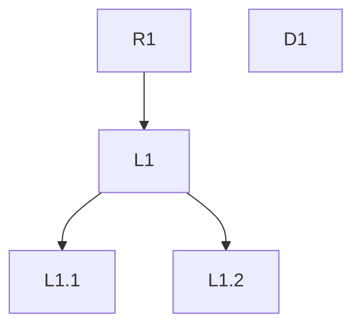

# strict-leftovers — design

Date: 2026-10-15
Package: `strict-workday`
Skill: `strict-leftovers`

## Problem

A task is small, but the work around it grows. Review findings, agent suggestions, side questions, and
the user's own "would be cool" remarks pile up in the session. Each one is plausible. Together they pull
the work away from the requirements, cost a context switch each, and leave the user with a drained head
and no clear picture of what is still open.

Two losses follow. Problems and decisions get lost between sessions and after context compaction. And
nobody can see which item grew out of which, so drift away from the requirement stays invisible until
the task has doubled.

## Intent

A journal of what is left on a task, kept so the list shrinks with every pass instead of growing.

- The user reads less: counts and the open list only, everything else on request.
- Nothing is reworded. Questions and decisions are stored verbatim, so the original meaning survives.
- The user sees what pulled in what, and how far each item is from a requirement.

## Goals

- `/strict-leftovers` scans the session since its last run and records new questions, findings, and
  decisions into one file per task.
- Every entry keeps the exact wording of its source message.
- Every entry links to where it came from: a requirement or another entry.
- The chat output shows three counts and the `Open` list, ordered so the most relevant item is first.

## Non-goals

- Deciding for the user. The skill records and orders; the user decides.
- Background capture. The skill writes only when invoked.
- Forecasting blast radius or scoring impact. Separate atomic skills may do that later.
- Creating tracker tickets. A backlog link is recorded only when the user supplies one.

## Anti-goals

The skill fails, even if it technically works, when:

- the `Open` list grows because of the skill itself — duplicates, split items, reworded copies;
- a recorded question or decision differs in wording from what was said;
- the chat output becomes another long text the user has to read.

## Artifacts

**Journal:** `.strict-ai/leftovers/<task-id>.md`, one file per task. The file is the record; the
conversation is not.

`<task-id>` resolves from an explicit argument, then a tracker key, then the branch name, lowercased to
kebab-case, 60 characters maximum. With none available it falls back to `YYYY-MM-DD-<topic>`.

**Registry:** `.strict-ai/leftovers/README.md`, one line per journal.

**Configuration:** `.strict-ai/configs/strict-workday.json`, key `strict-leftovers`. No file ships.

| Field | Default | Meaning |
|---|---|---|
| `driftDepth` | `3` | depth at which an item counts as drift |
| `stallRuns` | `3` | runs in a row without `Open` shrinking before the stall rule fires |

## Sources

Read on every run, each only when the agent can reach it:

- the current session, from the first source available, in order:
  1. the host's session transcript file — verbatim and complete, it survives context compaction;
  2. a session memory store, when installed — quotes from it carry `source: <store>`;
  3. the visible context;
- PR review comments, automated and human;
- the tracker ticket: description and comments;
- messengers available to the agent, filtered to the task.

## Stall rule

After `stallRuns` runs in a row without `Open` shrinking, the output opens with
`🟧 Stall Open <n> (+<growth>).` Entries at `driftDepth` or deeper carry `drift` in the tree. The skill
moves nothing on its own.

## Journal format

```markdown
# PROJ-123 leftovers

DoD: "<verbatim>"

## Requirements
- R1 · <title> · "<verbatim>"

## Open
- L1.1 · <title> · new · agent · high · Q1 · from L1 · depth 2 · 2026-10-15 · review PR #12
  "<question verbatim>"

## Decided
- L1 · <title> · decided · user · from R1 · depth 1 · 2026-10-15
  "<question verbatim>"
  → "<decision verbatim>"

## Later
- L1.2 · <title> · viewed · user · from L1 · depth 2 · 2026-10-15
  "<question verbatim>"
  → backlog: PROJ-140

## Detached
- D1 · <title> · new · user · 2026-10-15
  "<remark verbatim>"

## Graph

```

Entry fields:

| Field | Values |
|---|---|
| id | `R<n>` requirement; `L<n>` depth-1 entry; a child adds `.<n>` to its parent's id; `D<n>` detached. The id survives moves between sections and trees; only a new parent changes it, keeping the old one as `was` |
| status | `new` → `viewed` → `decided` |
| by | `user` \| `agent` |
| severity | `blocker` \| `critical` \| `high` \| `medium` \| `low`, assigned by the skill per the table below |
| stated | the severity label the source gave, kept as-is |
| quadrant | Eisenhower `Q1`–`Q4`: importance = path to a requirement, urgency = severity `high` or above, or a stated deadline |
| from | parent id; absent for detached entries |
| depth | edges from the nearest requirement; absent for detached entries |
| source | where it was said: session, review, PR, tracker, messenger, or a session memory store |

Entries move between sections. They are never rewritten or deleted.

### Severity

The skill assigns severity by user impact, not by the reviewer's label. When two levels fit, it takes
the higher one and states why in one line.

| Level | Definition | Example |
|---|---|---|
| `blocker` | The task cannot be merged or shipped. | Build or tests fail. The main scenario of a requirement does not work. |
| `critical` | Harm with no workaround. | A vulnerability. Money loss. Personal-data leak. Data corruption. A regression breaks an existing feature. |
| `high` | A common scenario works wrong. A workaround exists. | A requirement behaves wrong in the typical case. Visible performance or visual degradation. |
| `medium` | A rare scenario works wrong. | An edge case with a simple workaround. |
| `low` | No effect on behavior. | Style, naming, a refactoring suggestion. |

Graph nodes are colored by status. Detached nodes stand alone, unconnected to any requirement.

## Behavior

On `/strict-leftovers [task-id]`:

1. Resolve the journal. Create it on first run, filling `DoD` and `Requirements` verbatim from the
   session or tracker.
2. Read the session from the last recorded entry onward.
3. Extract new questions, findings, and decisions. Store each quote verbatim.
4. Merge duplicates into one entry that lists every source.
5. Link each new entry to its parent and compute its depth.
6. Mark entries `viewed` when the user referenced them, and `decided` when the user stated a decision.
   The decision is stored verbatim under the question.
7. Route entries:
   - a user remark like "would be cool", "not sure", or "need a ticket" with no explicit link to a
     requirement → `Detached`;
   - an entry the user deferred → `Later`;
   - everything else undecided → `Open`.
8. Rewrite the graph block.
9. Print the chat output.

## Chat output

The output is a folder-style tree, read at a glance:

```text
## strict-leftovers output

🟧 Stall Open 5 (+3).

Leftovers
1/5 R1 · Pencil icons in the table | Blocked by L4
├─ [ ] 0/1 L1 · Buttons break the pencil pattern | medium
│  └─ [ ] L1.1 · <entry title> | medium
├─ [x] L2 · Pencil opens inline editing
├─ [ ] L3 · Rename editCell → onEditCell | low ▼ critical
└─ [ ] L4 · Export menu no longer opens | critical ▲ medium

Detached
- D1 · Annotate video frames during review | user
```

- Requirements are always the roots. One `Leftovers` tree holds open and decided entries in place;
  `Later` and `Follow-ups` become separate trees only when they have entries. Both repeat the full path
  from the requirement to each moved entry. `Detached` is a flat list.
- Siblings sort by id, ascending, whatever their status.
- Every entry shows `[ ]` or `[x]`; a branch adds `<decided children>/<children>` after it.
- The id and a short title come first; meta follows `|`.
- The stall line, or `✅ Task Done: please, review the leftovers. Is the task finished?` when the task is done, opens the
  output. Absence lines close it.

## Done

Done is tracked per requirement, then per task.

**Requirement done.** Each `R<n>` is judged on its own subtree. It is done when all hold:

1. **Hard gate.** No open entry in the subtree is `blocker`, `critical`, or `high`.
2. **Direct entries.** Every depth-1 entry, one that grew straight from the requirement, is `decided`.
3. **Must entries.** Every entry the user marked `must` is `decided`.

The tree shows progress per requirement:
`4/4 R1 · <title> | gate ok`, `2/5 R2 · <title> | Blocked by L7`.

There is no percentage threshold. No study found supports a universal share of resolved items, and
most review comments never lead to a code change, so a high ratio would force the user through noise.

**Task done.** Both hold:

- every requirement is done;
- every check is green.

Task done changes only the first line of the output; the trees print as usual.

**After task done.** The trees grow until task done; then the skill asks whether the task is finished.
Finished: the user's answer is recorded verbatim and the task is over. Not finished: the skill proposes
exactly the undecided entries from the journal, nothing outside the trees; each one the user picks gets
`must` and joins its requirement's gate, and runs go on until the next task done. An entry becomes
`decided` only with proof, deterministic when reachable. The user may move entries between trees on
any run; the skill moves nothing on its own.

## Evidence

Each design choice rests on a measured effect:

| Choice | Evidence |
|---|---|
| Write only on invocation | Interruptions add stress and time pressure (Mark et al. 2008); resumption averages about 25 minutes (Mark et al. 2005) |
| Merge before adding | People default to adding and overlook subtraction (Adams et al., Nature 2021) |
| Verbatim decisions in a file | Written plans remove intrusive thoughts about unfinished goals (Masicampo & Baumeister 2011) |
| Depth and drift | Scope creep hit 52% of projects (PMI Pulse 2018) |
| Skill assigns severity | About a third of "bugs" are misclassified (Herzig et al. 2013) |
| Gate by severity, no ratio | LLM review comments lead to code changes in 38.7% of cases, human ones in 44.5% (Atlassian, 54k comments, arXiv 2601.01129); about 15% of review comments point to a defect (Czerwonka et al., Microsoft) |
| Eisenhower quadrant | A visual label. The urgency bias it targets is measured (Zhu et al. 2018); the matrix itself has no controlled trials |

## Resolved calls

Settled during the builder check. Each is the author's call, not the user's.

- **Requirements.** One `R<n>` per atomic requirement or DoD criterion, verbatim. Any run may append
  new `R<n>` entries. With none found, the task title becomes `R1`.
- **DoD.** Copied verbatim from the session once, on first run. The skill invokes nothing to get it.
- **Cursor.** The journal header stores `last-run` (UTC) and `open-count`. Each run reads the session
  source from `last-run` onward and drops quotes already in the journal. Host transcript paths live in a
  binding table in `references/host-bindings.md`, one row per host, so `SKILL.md` stays vendor-neutral.
- **Duplicates.** A duplicate needs the same decision, not just the same topic. The first wording stays
  as the entry's quote. Every other wording is kept verbatim under `also:` with its source.
- **Parent.** The agent infers the parent from content. A user remark or an agent finding with no
  inferable parent goes to `Detached`.
- **Moves.** Section, status, `from`, and `depth` may change; quotes never do. A detached entry the user
  links to a requirement moves to `Open` and gets a parent and depth.
- **Delta.** `(+n)` compares against `open-count` from the previous run.
- **Done inputs.** Taken from the session and cheap local reads: git state and the last check output
  visible in the session. A fact the skill cannot see counts as not met.
- **Unavailable source.** Skipped. The output prints `<Source> data is unavailable.` and the run
  continues.

## Builder's calls

- SKILL.md wording, trigger description, and eval queries.
- Exact Mermaid styling.
- How the user's reference to an entry is detected for `viewed`.
