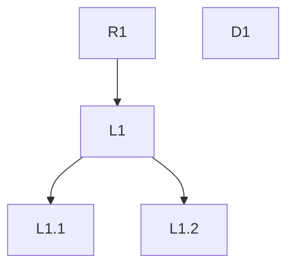

# Journal format

## Template

````markdown
# PROJ-123 leftovers

last-run: 2026-10-15T14:02:00Z · open-count: 4 · stall: 0

DoD: "<verbatim>"

## Requirements
- R1 · <title> · "<verbatim>"

## Open
- L1.1 · <title> · new · agent · critical · stated: medium · Q1 · from L1 · depth 2 · 2026-10-15 · review PR #12
  "<question verbatim>"
  also: "<other wording verbatim>" · session

## Decided
- L1 · <title> · decided · user · from R1 · depth 1 · 2026-10-15 · session
  "<question verbatim>"
  → "<decision verbatim>"

## Later
- L1.2 · <title> · viewed · user · from L1 · depth 2 · 2026-10-15 · session
  "<question verbatim>"
  → backlog: PROJ-140

## Detached
- D1 · <title> · new · user · 2026-10-15 · session
  "<remark verbatim>"

## Follow-ups
- L1.2 · candidate ticket
  - L1.2.1 · from L1.2

## Graph

````

`Follow-ups` appears only after the task is done.

## Entry fields

| Field | Values |
|---|---|
| id | `R<n>` requirement; `L<n>` depth-1 entry, numbered across all requirements; a child adds `.<n>` to its parent's id (`L1.2.1`); `D<n>` detached entry. Ids are never reused |
| title | the skill's summary of the quote, at most 8 words, in the user's language |
| was | the entry's previous id, set when a move changed it |
| status | `new` → `viewed` → `decided` |
| by | `user` \| `agent` |
| severity | `blocker` \| `critical` \| `high` \| `medium` \| `low`, assigned per the severity table |
| stated | the severity label the source gave, kept as-is; omitted when the source gave none |
| quadrant | Eisenhower `Q1`–`Q4`: importance = path to a requirement, urgency = severity `high` or above, or a stated deadline |
| from | parent id; absent for detached entries |
| depth | edges from the nearest requirement; absent for detached entries |
| source | where it was said: session, review, PR, tracker, messenger, or a session memory store |
| also | other wordings of the same entry, verbatim, each with its source |

Quotes never change. Section, id, title, status, `from`, and `depth` may change.

## Severity

Assigned by user impact, not by the source's label. When two levels fit, take the higher one and state why in one line.

| Level | Definition | Example |
|---|---|---|
| `blocker` | The task cannot be merged or shipped. | Build or tests fail. The main scenario of a requirement does not work. |
| `critical` | Harm with no workaround. | A vulnerability. Money loss. Personal-data leak. Data corruption. A regression breaks an existing feature. |
| `high` | A common scenario works wrong. A workaround exists. | A requirement behaves wrong in the typical case. Visible performance or visual degradation. |
| `medium` | A rare scenario works wrong. | An edge case with a simple workaround. |
| `low` | No effect on behavior. | Style, naming, a refactoring suggestion. |

## Graph

- One node per entry; edges follow `from`.
- Requirements are roots.
- Detached entries are unconnected nodes.
- Node style shows status: `new`, `viewed`, `decided`.
